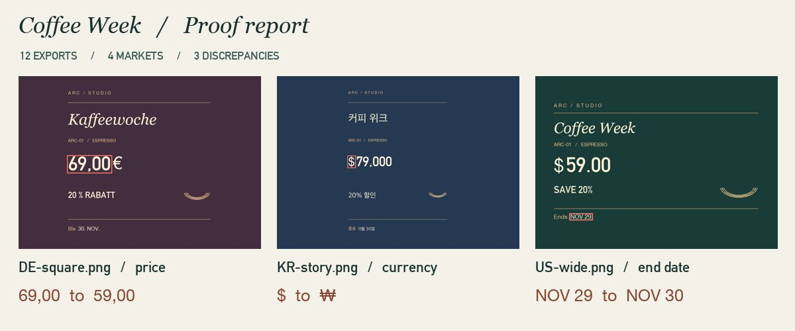

# Multilingual Promo Proof

Check the offers customers actually see on localized posters. Give a vision-capable agent the approved campaign sheet and the finished artwork. Get a report that points to the exact export, field and image detail that needs a correction.



## Coffee Week example

A fictional espresso campaign has four markets and three placements per market. Across 12 exports, the sample report checks 48 offer fields and identifies three discrepancies.

| Export | Field | On the poster | Approved |
| --- | --- | --- | --- |
| DE-square.png | Sale price | 69,00 | 59,00 |
| KR-story.png | Currency | $ | ₩ |
| US-wide.png | End date | NOV 29 | NOV 30 |

[Approved workbook](examples/coffee-week/campaign.xlsx) · [Poster exports](examples/coffee-week/posters/) · [Downloadable HTML report](examples/coffee-week/report.html)

## Install and use

Install the skill in an agent client that supports image input and local files.

```sh
npx skills add demonlee0727-glitch/multilingual-promo-proof --skill multilingual-promo-proof
```

Alternatively, copy [the skill directory](skills/multilingual-promo-proof/) into your project's `.agents/skills/` folder. For evidence reports, install Python 3.9+ and the dependencies in [requirements.txt](requirements.txt).

> Use $multilingual-promo-proof to check these posters against my approved workbook. Inspect every market and placement. Show the approved and printed values, attach marked crops, and list anything too small to read.

The agent reads the artwork, identifies each offer in context and records its location. A local Python helper compares those readings with the sheet, then writes a self-contained HTML report and machine-readable JSON. The helper takes visual readings as input. Your agent's image-processing and privacy settings apply when it inspects artwork.

## Your campaign sheet

Use UTF-8 CSV or XLSX and one row per export. The sample [CSV](examples/coffee-week/campaign.csv) doubles as a template. Use the approved local spelling of offer text, dates and qualifiers. For a campaign sheet organized by market and SKU, have the agent map verified exports to those rows first.

| asset | market | sku | price | currency | discount | end_date |
| --- | --- | --- | --- | --- | --- | --- |
| DE-square.png | DE | ARC-01 | 59,00 | € | 20 % RABATT | 30. NOV. |

Market codes are independent of language. Keep the currency separate from the numeric amount. The skill also recognizes Chinese column headings. It flags unknown assets, missing approvals, uncertain readings and missing artwork for review.

## Reproduce the example

From the repository root, run the following with a fresh output directory. The included [visual readings](examples/coffee-week/readings.json) let you reproduce the comparison without a model call. To test the visual step, give your agent only the workbook and the poster directory.

```sh
python3 -m pip install -r requirements.txt
python3 skills/multilingual-promo-proof/scripts/proof.py \
  --sheet examples/coffee-week/campaign.xlsx \
  --images examples/coffee-week/posters \
  --readings examples/coffee-week/readings.json \
  --out coffee-week-audit
```

Open `coffee-week-audit/report.html`. Each discrepancy includes a marked crop, the observed value and the approved value. Unknown or unreadable fields have a separate review status. A clean report covers the supplied images, fields and readings.

## Optional Figma text-fit checker

The [development plugin](companions/figma-text-fit/) adapts the original multilingual poster checker. In Figma Desktop, import its `manifest.json` through **Plugins → Development → Import plugin from manifest**. Select a single plain text layer, paste one approved translation per line and choose **Check text fit**. The plugin measures each translation at the source width with the original typography and reports excess height in pixels. It requires the source fonts and a uniformly styled text layer.

Use the agent to audit exported artwork and the Figma companion to measure text before export.
